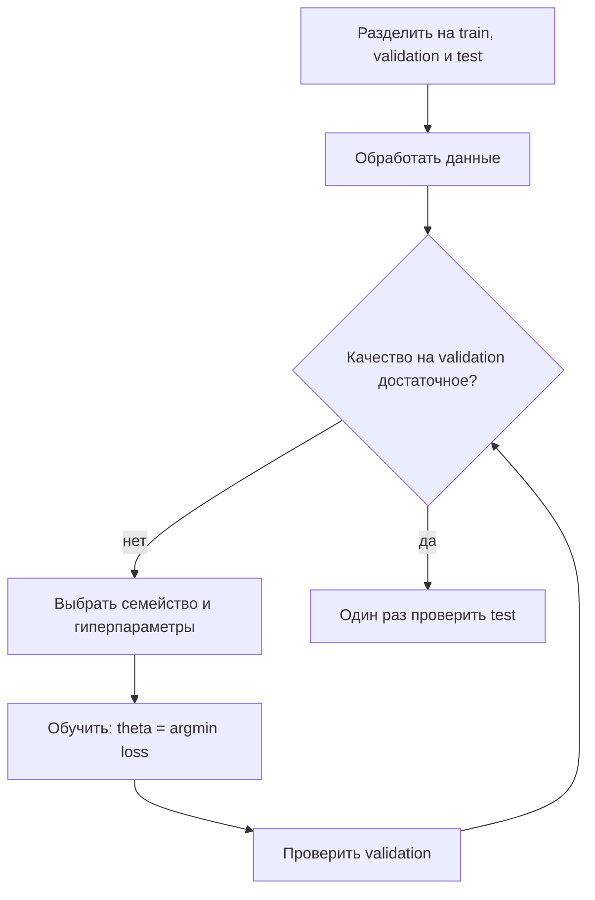

# Лекция 1. Введение в машинное обучение

Григорий Лелейтнер. Главный тезис лекции: машинное обучение модульное. Семейство моделей, функция потерь, способ подбора параметров и схема проверки можно менять по отдельности и так подбирать рабочую связку.

Видео: [YouTube](https://www.youtube.com/watch?v=LcvKd42DGQU)
Слайды: [Введение в машинное обучение.pdf](https://github.com/DeepLearningSchool/part_1_ml_cv/blob/autumn26/week_01_ml_intro/Lecture/%D0%92%D0%B2%D0%B5%D0%B4%D0%B5%D0%BD%D0%B8%D0%B5%20%D0%B2%20%D0%BC%D0%B0%D1%88%D0%B8%D0%BD%D0%BD%D0%BE%D0%B5%20%D0%BE%D0%B1%D1%83%D1%87%D0%B5%D0%BD%D0%B8%D0%B5.pdf)

## Три типа задач

Картинка «все виды ML» на слайде — ориентир, не список для заучивания. Часть задач лежит между классами. Запомнить нужно три больших класса.

![[l1_ml_types.png|720]]

*Слайд лекции. Три класса и примеры вокруг них. Подписи на ветках заучивать не нужно.*

[[Введение в искусственный интеллект#Обучение с учителем|Нейросети]] в этом курсе почти всегда решают задачи с учителем, поэтому дальше лекция про них.

- **Без учителя.** Есть объекты, ответов нет. Пример: кластеризация транзакций или клиентов, чтобы по-разному показывать рекламу. Нужно что-то сделать с самими данными.
- **С подкреплением.** Алгоритм действует в среде и за действие получает награду или штраф. На вводной лекции это [[Введение в искусственный интеллект#От узкой модели к универсальной|обучение с подкреплением]] на играх. Цель — максимум суммарной награды. AlphaGo наиграл сам с собой миллионы партий и выработал стратегии, похожие на человеческие. Сегодня это горячая тема, на этой лекции её не разбирают.
- **С учителем.** Есть объекты, для которых ответ уже известен. «Учитель» — это размеченная выборка, а не человек, который сообщает правило.

## Постановка обучения с учителем

- *X* — множество объектов.
- *Y* — множество ответов.
- *y*: *X* → *Y* — истинная зависимость. Её же называют законом природы, таргетом, целевой переменной. Её и хотят восстановить.

Пример: объект — человек, ответ — кликнет ли он по рекламе. Функция нужна, чтобы не тратить показ на тех, кто не кликнет.

Как только объект удаётся записать вектором чисел, почти весь аппарат ML применим. Обучающая выборка — таблица: строка — объект, столбцы — признаки, отдельно вектор ответов.

> [!tip] Тезис
> Признак (feature) — одно число в этой строке. Слово «фича» значит то же самое.

## Признаки и виды ответов

### Признаки

- **Числовые** — обычные числа: площадь, год, расстояние.
- **Категориальные** — метки без порядка. Название района нельзя выстроить в «больше / меньше». В модель их всё равно переводят в числа, но способ перевода нужно выбирать отдельно: модели работают с числами. На семинаре это [[Сем1. Pandas, Matplotlib#Категории: one-hot и label|one-hot и label encoding]], на скоринге — [[Сем1. Feature engeneering#Категории и one-hot|то же one-hot]] уже с оглядкой на test.
- **Порядковые** — метки с внутренним порядком: состояние дома «плохое < среднее < хорошее < отличное». Порядок полезно сохранить.

Дату в модель целиком не кладут. Варианты с лекции: число секунд с 1970 года (timestamp, числовой признак) или три признака — год, месяц, день. Год числовой, месяц и день удобно считать порядковыми.

### От вида Y зависит тип задачи

- **Классификация.** *Y* конечное: {0, 1} или {1, 2, 3}. Клик / не клик — бинарная классификация.
- **Регрессия.** *Y* — действительное число. Цена дома.
- **Ранжирование.** Ответ — порядок от 1 до *n*. Классы упорядочены, это не обычная классификация «каждый документ в свою ячейку». Почему номер позиции нельзя учить как обычную регрессию — в [[Лекция 1. ДОП ШАД#Постановка и типы задач|дополнении из ШАД]].

### Три примера со слайдов

- **Ирисы Фишера.** Длина и ширина лепестков и чашелистиков, три вида: setosa, versicolor, virginica. Классификация, все четыре признака числовые.
- **Цена дома.** Регрессия. Числовые: расстояние до метро, комнаты, площадь, год. Порядковый: оценка состояния. Категориальный: название района.
- **Поиск.** По запросу вернуть самые полезные документы. Ранжирование. Признаки сложные: строки, ключевые слова, популярность, ссылки между страницами. В классическую модель их не кладут как есть, нужна предобработка: так устроен весь [[Сем1. Feature engeneering|семинар по feature engineering]].

## KNN

Самый прямой способ воспользоваться выборкой. Тот же алгоритм на семинаре считают руками и вызывают из sklearn: [[Сем1. Sklearn#kNN вручную|kNN]]. Обучение — запомнить матрицу признаков и вектор ответов. Это ленивое обучение: до запроса ничего не считается. Взвешенные соседи, манхэттенская и косинусная метрики — в [[Лекция 1. ДОП ШАД#KNN глубже|дополнении из ШАД]].

![[knn.png]]

*Слайд лекции. Для классификации ответ — класс, которого среди k соседей больше. Картинки: unite.ai.*

Предсказание:

1. Приходит вектор *x*.
2. Ищутся *k* ближайших объектов выборки.
3. Классификация: самый частый класс среди них. Ничья не принципиальна, можно вернуть оба. Регрессия проще: среднее ответов соседей.

*k* задают до обучения, из данных оно не находится. Это **гиперпараметр**. От него ответ меняется: при трёх соседях может победить один класс, при пяти — другой. Подбор *k* — отдельная работа, не шаг `fit`.

Метод стоит на слабом допущении: близкие по признакам объекты имеют близкие ответы. Для рекомендаций «что нравится похожим людям» KNN ещё встречается. Как универсальная модель он слабый, и лекция разбирает его как раз чтобы на простом примере увидеть типичные проблемы.

### Проклятие размерности

![[curse.png]]

*Слайд лекции. В двух признаках в окрестность попадает много объектов, в трёх — меньше, в десятках признаков ближайшие соседи оказываются далеко.*

Размерность — длина вектора признаков. С её ростом объём пространства растёт так быстро, что вблизи новой точки никого нет, даже если объектов стало в десять раз больше. Плюс растёт цена перебора расстояний. Это свойство всех вычислительных методов, не только KNN. С ним считаются, а не «лечат до конца».

### Масштаб признаков

Близость задаёт метрика. Обычный выбор — евклидово расстояние: корень из суммы квадратов разностей координат. KNN из-за этого называют метрическим алгоритмом; термин запоминать не обязательно.

Если признаки в разных масштабах, расстояние врёт. Расстояние до метро в метрах — тысячи, число комнат — единицы. Разница в 5 метров весит как разница в 5 комнат, хотя 5 метров ничего не значат, а 5 комнат значат много. Число комнат почти не влияет на соседа.

Простой ремонт: из каждого признака вычесть среднее и поделить на стандартное отклонение. В коде это [[Сем1. Pandas, Matplotlib#Train/test и масштабирование|StandardScaler и MinMaxScaler]], и учат их только на train. Другой путь — выучить вес координаты. Та же беда у нейросетей: слишком крупный масштаб делает градиент неустойчивым, и сеть может не обучиться. Инициализация весов рассчитана на разумный масштаб, примерно от −1 до 1. Перед сетью признаки масштабируют заранее. Функция активации сама вход не нормирует; batch norm на входе возможен, но проще нормировать данные руками.

## Как устроено обучение

Нужна функция *a*, которая хорошо приближает истинную зависимость и считается на компьютере: сравнения, умножения, сложения. Таких функций слишком много, поэтому заранее сужают семейство.

**Параметризованное семейство** *F* — набор алгоритмов, где каждый задаётся параметром θ. Пример со слайда: можно ли ребёнку на аттракцион. Признаки — рост *x₁* и возраст *x₂*. Семейство пороговых правил:

> a(x) = [x₁ > a] и [x₂ > b], θ = (a, b), θ ∈ ℝ²

Каждому θ соответствует ровно один алгоритм. **Обучение** — выбор θ, которому соответствует лучший для задачи алгоритм.

### Функция потерь

Любая функция от истинного *y* и предсказания *a(x)*, которая выдаёт число: чем больше, тем хуже предсказание. Слайд даёт две:

- квадратичная: (*y* − *a(x)*)²
- абсолютная: |*y* − *a(x)*|

Прибавить константу или умножить на положительную константу минимум не сдвигает: всё равно ищут наименьшее значение. В текстах ту же величину чаще называют loss.

### Эмпирический риск

Средний лосс по обучающей выборке размера ℓ:

> Q(θ) = (1/ℓ) · Σ L(yᵢ, a(xᵢ, θ))

> θ* = argmin_θ Q(θ)

*argmin* возвращает тот θ, на котором выражение справа минимально. Строго говоря, минимум может не существовать или быть недостижимым. Почти никогда его не находят точно. Сам способ поиска зависит от семейства: у нейросети один алгоритм, у [[Лекция 2. Линейные модели#Точное решение линейной регрессии|линейной регрессии]] — закрытая формула или градиент, у [[Лекция 2. Линейные модели#Логистическая регрессия|логистической]] — только градиент.

> [!warning] Важно
> Эмпирический риск — термин статистики. Дальше по курсу средний лосс тоже называют лоссом. Теоремы про минимизацию эмпирического риска объясняют, почему найденные параметры вообще о чём-то говорят, а не просто подогнаны под таблицу.

## Линейная регрессия и переобучение

Самое простое семейство для регрессии:

> a(x) = θ₀ + θ₁x₁ + … + θₙxₙ

Лосс почти всегда — средний квадрат ошибки. Делить на ℓ или не делить для поиска минимума всё равно. Линейная регрессия здесь нужна как витрина переобучения, подробно её разберут позже.

Одного признака *x* мало: прямая θ₀ + θ₁x не опишет сложную зависимость. Новые признаки — степени: *x, x², …, xⁿ*. Линейная регрессия по ним — полиномиальная:

> a(x) = θ₀ + θ₁x + θ₂x² + … + θₙxⁿ

![[overfit.png]]

*Слайд лекции. Степень 1 — прямая мимо облака. Степень 2 — парабола, уже хороший компромисс. Степень 300 проходит через точки и дико осциллирует.*

В жизни график тысячемерный, «на глаз» степень не выбрать. Хочется ещё меньше ошибку на точках — и модель степени 300 запоминает случайное расположение конечной выборки. На новых точках той зубчатой зависимости нет.

> [!tip] Тезис
> Переобучение: качество на train заметно лучше, чем на validation или test. Слишком гибкая модель выучила закономерности, которые появились только из-за конечности выборки. На дереве это видно по MSE: [[Сем1. Sklearn#Дерево и переобучение|ноль на train и большая ошибка на test]]. Три картинки «слишком просто / в самый раз / запомнила выборку» — в [[Лекция 1. ДОП ШАД#Обобщение и переобучение|дополнении из ШАД]].

Тот же эффект у KNN при *k* = 1. Ближайший сосед обучающей точки — она сама, эмпирический риск на train равен нулю. На новых точках ошибка уже не ноль: у границ классов появляются случайные выступы.

----
Метрика похожа на лосс, но модель под неё не оптимизируют. Ею смотрят качество на числах, которые в argmin не подставляли. Почему константный прогноз для MAE — медиана, а для MSE — среднее, — в [[Лекция 1. ДОП ШАД#Лосс и константный прогноз|дополнении из ШАД]]. Дальше — семинар и следующая лекция.

## Train, validation, test

- **Train** — на этих данных подбирают θ.
- **Validation** — после каждого круга смотрят качество и решают, менять ли модель, данные или гиперпараметры.
- **Test** — один финальный замер, когда на validation уже всё устраивает. Это оценка того, что скорее всего получится «в проде».

Зачем отдельный test, если validation уже ловит переобучение. Пока исследователь снова и снова смотрит validation, информация утекает в модель через него. Пример с лекции: перебрали *k* от 10 до 5 и оставили 5, потому что на validation так лучше. Число *k* = 5 модель фактически узнала с validation. На серьёзной задаче, где 1% — это жизни, так оценивать себя нельзя. Test эту утечку не видел.

Test не обязателен, если проект учебный, исследовательский или цена ошибки невелика. На Kaggle test отделяет организатор, на нём и идёт соревнование. Если test отрезать жалко, validation часто тоже называют test. При трёх частях это разные вещи, при двух — одно и то же.

На полиноме высокой степени лосс на train может быть почти ноль (кривая через все синие точки), а до зелёных тестовых точек — далеко. У KNN с *k* = 1 то же: ноль на train, не ноль на test. Обнаружили переобучение — дальше лечат его по-своему для каждой модели.

## Кросс-валидация

Данных жалко. Кросс-валидация даёт честную оценку, не откладывая кусок навсегда. Вызов в sklearn — [[Сем1. Sklearn#Кросс-валидация и GridSearchCV|cross_validate и GridSearchCV]]. Когда хватает одного hold-out, зачем стратификация и где утекает test — в [[Лекция 1. ДОП ШАД#Hold-out, фолды и утечки|дополнении из ШАД]].

![[cv.png]]

*Слайд лекции. Пять сплитов, на каждом новая модель. Фолд, на котором считают качество, в обучении этой модели не участвовал.*

1. Выборку делят на 5 фолдов.
2. На каждом шаге учат новую модель на четырёх фолдах и считают качество на оставшемся.
3. Пять чисел усредняют.

Линейную регрессию, логистическую, KNN и даже бустинг так учить нормально. Нейросеть учат часы, дни или недели, пять прогонов обычно не делают. Для лёгких моделей кросс-валидация — обычный инструмент, для нейросетей — почти никогда.

## Алгоритм решения задачи

Сводка со слайда «Algorithm 1». Test в этот цикл не входит: его смотрят один раз в конце.

> [!tip] Тезис
> Модульность на практике: данные, семейство, лосс, гиперпараметры и способ оценки крутятся по отдельности, пока validation не станет приемлемым. Test в этот круг не входит.
