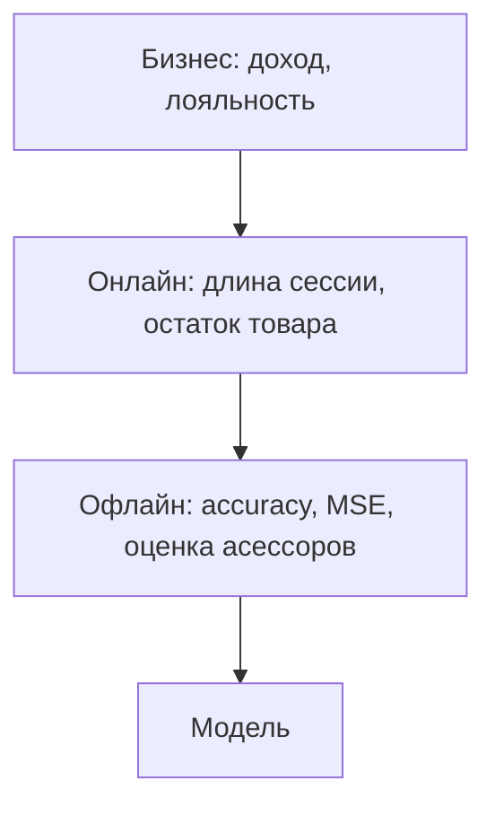

# Лекция 1. ДОП ШАД

Дополнение к [[Лекция 1. Введение в машинное обучение]] из [учебника ШАД](https://education.yandex.ru/handbook/ml/). Здесь то, что углубляет уже пройденное: постановку задачи, признаки, переобучение, kNN, метрики и честную оценку качества. Линейные модели, бустинг и теория обобщения оставлены следующим лекциям.

Формулы на карточках — те, что учебник вводит в тексте параграфа. Графики перерисованы по тем же примерам: три регрессии, ширина окна, ROC, фолды, сетка против случайного поиска.

Источники:

- [1.3. Машинное обучение](https://education.yandex.ru/handbook/ml/article/mashinnoye-obucheniye)
- [2.3. Метрические методы](https://education.yandex.ru/handbook/ml/article/metricheskiye-metody)
- [3.2. Метрики классификации и регрессии](https://education.yandex.ru/handbook/ml/article/metriki-klassifikacii-i-regressii)
- [3.3. Кросс-валидация](https://education.yandex.ru/handbook/ml/article/kross-validaciya)
- [3.4. Подбор гиперпараметров](https://education.yandex.ru/handbook/ml/article/podbor-giperparametrov)

## Постановка и типы задач

Машинное обучение — алгоритмы, которые улучшаются благодаря опыту. Модель — функция из объектов в предсказания. Датасет — объекты плюс ответы, если ответы известны.

У задач, которые трудно запрограммировать правилами (перевод, диагноз, «что на картинке», цена квартиры), три общих свойства: ответ можно записать как функцию, единственно верного ответа часто нет, и примеры правильных ответов уже есть.

![[shad_y_sets.png|575]]

*Множество ответов Y и есть тип задачи. Вектор из нескольких чисел (температура, влажность, давление) — всё ещё регрессия.*

> [!tip] Тезис
> Ранжирование не сводят к классификации «документ номер 1, номер 2, …». Появился новый документ релевантнее текущего топа — все номера позиций сдвигаются, и выученное соответствие можно выбрасывать. И не сводят к обычной регрессии: абсолютные числа не важны, важно только, чтобы более релевантный объект получил число побольше. Поэтому и лосс, и метрика другие.

Детектирование котика на картинке — не один тип задачи. «Есть котик или нет» — классификация. Координаты рамки — регрессия. Робот, который учится запрыгивать на стол по награде в симуляции, — [[Введение в искусственный интеллект#От узкой модели к универсальной|обучение с подкреплением]], а не обучение с учителем: перебрать все траектории и заранее проставить им ответы слишком дорого.

Поиск товаров, которые часто покупают вместе, — обучение без учителя: ответов нет, цель в структуре данных.

## Иерархия метрик

Офлайн-метрика на исторической таблице — не то, ради чего строят модель.

- Бизнес-метрику нельзя снять в момент обучения: она зависит не только от модели.
- Онлайн-метрика снимается с уже работающей системы.
- Офлайн-метрика считается до выката, по истории или по асессорам.
- Кроме числа бывают требования: ответ в реальном времени, модель влезает в телефон, предсказание можно объяснить, модель не дискриминирует группу пользователей.

Диагноз в учебнике показывает, почему одной accuracy мало:

- обычное отделение — доля верных диагнозов (accuracy);
- стигма от ложного диагноза — среди тех, кому поставили болезнь, доля действительно больных (precision);
- опасная заразная болезнь — не пропустить носителя (recall).

## Лосс и константный прогноз

==Лосс== нужен, чтобы свести обучение к оптимизации. От него хотят удобных свойств, например дифференцируемости. ==Метрика== — внешний критерий: она смотрит на предсказания, а не на то, удобно ли по ней считать градиент.

> [!warning] Важно
> В регрессии MSE бывает и лоссом, и метрикой. В бинарной классификации они почти всегда разные: лосс — кросс-энтропия от логитов, метрика — accuracy от уже выбранных меток. На вход кросс-энтропии идут логиты, на вход accuracy — уже выбранные классы.

* **Логиты (logits)** — это сырые, необработанные предсказания (выходы), которые выдает нейросеть или алгоритм логистической регрессии для задач классификации **до того**, как они превратятся в понятные человеку вероятности

Константная модель «всем квартирам одна цена» уже даёт два разных ответа. Производная MAE по константе обнуляется там, где слева и справа от неё поровну цен: это медиана. Производная MSE обнуляется в среднем.

![[shad_mae_mse.png|692]]
![[shad_mean_median.png|669]]
*Несколько очень дорогих квартир тянут среднее вправо. Медиана остаётся среди типичных цен. Это тот ориентир, с которым на [[Сем1. Sklearn#MSE, RMSE, MAE, R²|семинаре]] сравнивают R²: константа «предсказать среднее train».*

Accuracy как метрика линейного классификатора не дифференцируема, поэтому под неё подставляют другой лосс. Шаг градиентного спуска при этом остаётся гиперпараметром.

Для линейного классификатора выбор лосса определяет саму модель: 

1. **Log-Loss / Cross-Entropy (Логистическая регрессия):**  
    Лосс штрафует модель тем сильнее, чем дальше вероятность от истинного ответа. Функция абсолютно гладкая, градиенты текут прекрасно. 
2. **Hinge Loss (Метод опорных векторов / SVM):**  
    Штрафует модель, если объект попал на «чужую» территорию или подошел слишком близко к границе разделения (отступу). Тоже позволяет вычислять субградиенты.

![[Pasted image 20260929015901.png|579]]

![[Pasted image 20260929020012.png|696]]
## Признаки и грязные данные

Признак — свойство объекта. Признаковое описание — набор свойств, который видит модель. Таблица «строка — объект, столбец — признак» — самый удобный формат; если все столбцы числовые, это матрица.

- численные: рост, доход;
- категориальные: профессия, день недели;
- бинарные: да/нет, с ними работают и как с числами, и как с категориями;
- ординальные: класс опасности, курс студента — дискретные, но упорядоченные.

Тексты, фото и графы сами по себе в линейную модель не кладут. Извлечение из них чисел и есть feature engineering; для однородных типов данных это чаще нейросетевые представления, о них — [[Введение в искусственный интеллект#Обучение с учителем|вводная лекция]].

Проблемы данных, которые учебник ставит рядом:

- пропуск можно удалить, заполнить или оставить как сигнал. Сам факт пропуска иногда информативен. Деревья умеют пропуски сами, линейные модели и нейросети — нет. Практика заполнения — в [[Сем1. Feature engeneering#Пропуски, в том числе тихие|скоринге]] и в [[Сем1. Pandas, Matplotlib#Обзор таблицы и пропуски|Pandas]];
- выброс — ошибка сбора или редкий важный объект (очень богатый клиент). Выкидывать всех подряд нельзя;
- ошибки разметки неизбежны, даже если разметчики стараются;
- data drift — со временем меняется распределение или формат. Concept drift — меняется сама зависимость «признаки → ответ» (новые треки и новые вкусы в рекомендациях). Модель после деплоя надо мониторить и переучивать.

## Обобщение и переобучение

Идеальная модель «запомни всю обучающую выборку» бьёт любую метрику на train и бесполезна на новых объектах. Обобщающая способность — умение выучить закономерность, которая есть не только в этой таблице. Выборку поэтому режут на train и test: на train учат, метрику смотрят на test.

На одном признаке учебник сравнивает три регрессии. Пунктир — зависимость, которую хотим поймать, точки — она же плюс шум.

![[shad_three_fits.png]]

*Левая прямая не ловит изгиб. Средняя не обязана попасть в каждую жёлтую точку и всё равно идёт вдоль пунктира. Правая проходит через точки и у края выборки улетает.*

С ростом сложности MSE на train падает, иногда до нуля. На test она сначала падает, потом растёт.

![[shad_ucurve.png|698]]
> [!tip] Тезис
> Грубая мера сложности — число настраиваемых параметров. У прямой их два, у параболы три, у многочлена 11-й степени — двенадцать. Это не теорема, но модель с 10 тысячами параметров сложнее модели с тысячей. Для глубоких сетей учебник делает оговорку: бывает режим, где тестовая ошибка после роста снова падает. Пока для классических моделей правило другое: слишком сложная модель вредна.

Тот же рисунок — у [[Лекция 1. Введение в машинное обучение#Линейная регрессия и переобучение|полинома степени 300]] и у [[Сем1. Sklearn#Дерево и переобучение|дерева без ограничений]].

## KNN глубже

Фраза учебника: «скажи мне, кто твой друг, и я скажу, кто ты». Фазы обучения нет, выборку запоминают. Это lazy learning и непараметрическая модель: форма зависимости заранее не задана, в отличие от линейной регрессии. Ответ локальный — по соседям. База алгоритма — [[Лекция 1. Введение в машинное обучение#KNN|лекция]] и [[Сем1. Sklearn#kNN вручную|семинар]].

Класс нового объекта — самый частый среди k соседей. Частоты соседей можно выдать как оценки вероятностей: они неотрицательны и в сумме дают единицу, но это эвристика, не модель вероятности.

![[shad_knn_cls.png]]

При k = 1 или 2 граница сложная. Параметрами можно считать всю выборку, поэтому подстроиться под шум легко. На рисунке один синий объект внутри жёлтого облака при k = 1 вытягивает за собой «щупальце» своего класса. При k = 15 оно пропадает.

![[shad_knn_k.png|700]]
### Какую метрику брать

Обычный выбор — евклидова. Манхэттенская устойчивее к одному большому отличию в высокой размерности: квадрат раздувает этот один признак, модуль — нет. Косинусная не смотрит на длину вектора, поэтому её берут для текстов: удвоить все слова — не сменить тему. Жаккара считают прямо по множествам, без перевода в вектор. Эти функции неотрицательны и симметричны, но неравенство треугольника от них не требуют: в строгом смысле это не всегда метрики.

*  Коэффициент и расстояние Жаккара (Jaccard) созданы для сравнения **множеств** (объектов, которые состоят из уникальных элементов, где важен сам факт наличия, а не количество)
	
	То есть мы берем ==размер _пересечения_ множеств== (сколько элементов есть и там, и там) и делим на ==размер их _объединения_== (все уникальные элементы вместе). 
	
	**Пример:** Сравнение корзин покупателей в интернет-магазине.
    - Покупатель А купил: `{молоко, хлеб, сыр}`
    - Покупатель Б купил: `{молоко, хлеб, яблоки, бананы}`
    - Пересечение (общее): `{молоко, хлеб}` (2 элемента)
    - Объединение (всего): `{молоко, хлеб, сыр, яблоки, бананы}` (5 элементов)
    - Сходство Жаккара = 2/5 = 0.4 => рассотяние 1 - 0.4 = 0.6
	Нам не нужно превращать эти корзины в огромные числовые векторы с нулями и единицами — мы считаем метрику напрямую по спискам. 

---
![[shad_dist.png]]

![[shad_balls.png]]

*Слева — множество точек на расстоянии 1. Справа — вектор отличий (10, 0.1, …, 0.1) в 1000 координатах. В сумме квадратов почти весь вклад у одного признака, в сумме модулей он тонет среди остальных.*

Метрику подбирают как гиперпараметр. Если масштабы признаков разные, никакая метрика не спасёт, пока нет нормализации. Это то же, что [[Сем1. Pandas, Matplotlib#Train/test и масштабирование|StandardScaler]] на семинаре.

### Веса, ядро и окно

Обычный kNN считает соседей с равным весом и выбрасывает сами расстояния. Взвешенный вариант даёт близким больший вес. Вес может зависеть только от места в списке (линейно или экспоненциально затухать) или от расстояния через ядро.

![[shad_weighted.png]]

Ядро (K) положительно и не растёт с расстоянием. От вида ядра зависит гладкость, почти не качество. По гладкости учебник выстраивает их так: прямоугольное, треугольное, Епанечникова, биквадратное, гауссово. На практике берут прямоугольное, когда нужна простота, и гауссово, когда нужна гладкость. Ширину окна h подбирают заново на каждой задаче.

![[shad_kernels.png]]
![[Pasted image 20260930013146.png]]
![[shad_window.png]]

*Узкое окно (h) повторяет шум точек. Широкое почти не видит синус. Пунктир — зависимость без шума.*

Для регрессии взвешенное среднее соседей — **формула Надарая–Ватсона**. Если вместо среднего оставить голосование «как в классификации», метод схлопывается в одного ближайшего соседа: почти все ответы различны, у каждого «класса» не больше одного голоса, побеждает ближайший.

![[shad_nw.png]]

Плюсы: нет гипотезы о распределении, понятен, работает и в классификации, и в регрессии, годится как бейзлайн. Минусы: хранит всю выборку, медленный, чувствителен к масштабу и к бесполезным признакам. Метрическая близость должна совпадать со смысловой: две фотографии леса по пикселям могут быть далеко. Тогда сначала учат представление, а соседей ищут уже в нём.

Применения, которые учебник считает живыми: рекомендации «похожим нравится похожее», поиск документов по близким векторам, поиск аномалий, кредитный скоринг людей с похожей зарплатой и историей.

## Метрики классификации

![[shad_clf_metrics.png]]

Accuracy — доля верных меток по всем классам. На редкой болезни константа «все здоровы» даёт высокую accuracy и ноль пользы: почти все объекты и так отрицательные, а больных модель не находит. Она также не различает цену ошибки.

![[shad_confusion.png]]

*Слева положительный класс — тот, который ищем. Справа 950 здоровых и 50 больных: константа выигрывает по accuracy и проигрывает по recall.*

- precision = TP / (TP + FP) — среди тревог сколько настоящих. Словом «точность» иногда называют и accuracy, лучше говорить precision;
- recall = TP / (TP + FN) — среди больных сколько нашли;
- F1 — среднее гармоническое, когда precision и recall одинаково важны. Если одна важнее, берут Fβ с весом β.

==Константа «самый частый класс» — обязательный бейзлайн. Без неё непонятно, дала ли модель прирост.==

Многие классификаторы выдают число, а метку получают порогом. Ниже порог — больше положительных, растут и верные срабатывания, и ложные. Как из этого числа получается ROC-AUC и почему на [[Сем1. Feature engeneering|скоринге]] сдают именно его — в следующем разделе.

![[shad_auc.png]]

## ROC-AUC

На [соревновании по заявкам](https://www.kaggle.com/competitions/bank-issues-042022/leaderboard) из [[Сем1. Feature engeneering|семинара]] метрика одна: ROC-AUC. Модель должна упорядочить клиентов по скору «откроет счёт», а не угадать жёсткую метку 0/1.

Учебник приводит ту же ситуацию на примере оператора связи. Метка «уйдёт через месяц / останется» банку почти бесполезна. Нужен порядок: кому купон, кому скидку, кому новый тариф. В любой задаче, где важна очередь, а не бирка класса, метрика — AUC.

![[Pasted image 20261007012943.png]]
### Что считается

Берут все пары (клиент, который открыл счёт, клиент, который не открыл). Пара засчитана, если скор первого строго выше. AUC — доля таких пар.

![[shad_auc_formula.png]]

Если скоры двух классов разведены, почти каждая пара упорядочена верно и площадь близка к 1. Если скоры перемешаны, порядок случайный и площадь около 1/2. Площадь меньше 1/2 значит, что модель устойчиво ставит нули выше единиц: её порядок стоит перевернуть.

![[shad_score_hist.png]]
*Жёлтое — те, кто откроет счёт, серое — кто не откроет. Слева скор их разделяет, справа почти нет.*

Любое монотонное преобразование скора AUC не меняет: важен только порядок. Поэтому хорошо откалиброванные вероятности и просто «чем больше число, тем вероятнее единица» для AUC одно и то же. Качество самих вероятностей учебник мерит логистическим лоссом. AUC на это не смотрит.

Сам AUC градиентным спуском не оптимизируют: доля верных пар не дифференцируема. Модель учат другим лоссом, обычно кросс-энтропией, а AUC считают уже по готовым скорам.

### Как рисуется кривая

Объекты сортируют по скору от большего к меньшему. Порог едет сверху вниз.

- Встретили единицу — шаг вверх. TPR растёт на 1/n₊. Это recall: какую долю открывших счёт уже нашли.
- Встретили ноль — шаг вправо. FPR растёт на 1/n₋: какую долю тех, кто счёт не откроет, уже назвали положительными.

Старт в (0, 0): порог выше всех, положительных предсказаний нет. Финиш в (1, 1): порог ниже всех, положительны все. Площадь под лестницей и есть AUC.

Шесть объектов в порядке + − + − + −. Единиц три, нулей три, пар девять. Первая единица бьёт все три нуля, вторая — два, третья — один. Верных пар 6, AUC = 6/9.

![[shad_roc_steps.png]]

![[shad_roc.png]]
*Лестница того же порядка из шести объектов. Ниже три режима уже на гладкой кривой: идеал прижат к левому верхнему углу, рабочая кривая над диагональю, случайный классификатор — сама диагональ.*

### Когда AUC врёт

Учебник просит не тащить AUC в задачи, где смотрят только на верх списка. Площадь может быть почти единица, а первые места — сплошные нули.
![[shad_auc_top.png]]

Считается так. 10 клиентов открыли счёт, 1000 — нет. Модель поставила 10 нулей наверх, сразу под ними все 10 единиц, остальные 990 нулей в хвосте. Каждая единица выше 990 нулей и ниже 10 нулей. Верных пар 10 × 990 = 9900, всех пар 10 × 1000 = 10000, AUC = 0.99. Если банк обзвонит первые десять, он не попадёт ни в одного нужного клиента.

При редком положительном классе та же беда у всей ROC-кривой, не только у верха. FPR делит ложные тревоги на всех, кто счёт не открыл. Их толпа огромная, поэтому горстка ложных тревог почти не двигает кривую. Precision эти тревоги видит сразу: они стоят в знаменателе среди тех, кому уже «предсказали единицу».

Отсюда в учебнике вторая кривая на тех же скорах — PR. На скоринге организатор всё равно просит ROC-AUC: ему нужен порядок по всей выборке. PR имеет смысл смотреть самой, если решение принимается только по голове списка.

### PR-кривая

Те же объекты и тот же порог, другие оси. По X — recall, по Y — precision. Порог по-прежнему едет от «никого не назвали положительным» к «положительны все».

Recall при этом только растёт: в знаменателе все настоящие единицы, их число не меняется, а в числителе единицы лишь добавляются. Precision так не обязана. Ноль, попавший в уже отобранных, увеличивает FP и точность падает, хотя полнота стоит на месте. Поэтому кривая зигзагом, а не лестницей «только вправо и вверх», как ROC.

В самом начале положительных предсказаний нет, precision = TP / (TP + FP) делит на ноль. Учебник и sklearn начинают график из точки (0, 1).

Тот же порядок + − + − + −, единиц и нулей поровну:

| кого добавили | precision | recall |
| --- | --- | --- |
| старт | условно 1 | 0 |
| + | 1/1 = 1 | 1/3 |
| − | 1/2 | 1/3 |
| + | 2/3 | 2/3 |
| − | 2/4 = 1/2 | 2/3 |
| + | 3/5 | 1 |
| − | 3/6 = 1/2 | 1 |

![[shad_pr_steps.png]]
*Серая ломаная — precision после каждого объекта. Синие ступеньки держат precision той единицы, на которой полнота выросла, пока не встретится следующая. Пунктир — доля положительного класса, здесь 1/2.*

Площадь под этой кривой называют PR-AUC. Учебник считает её трапециями: между соседними точками проводят прямую и складывают площади. Average precision — та же кривая, но ступеньками, без наклонных отрезков. Ступенька имеет высоту precision в позиции очередной единицы и ширину прироста recall. На этом примере единицы стоят на местах 1, 3 и 5:

![[shad_pr_formula.png]]

AP = (1 + 2/3 + 3/5) / 3 ≈ 0.76. Число одно, сравнивать модели им удобно. От PR-AUC оно чуть отличается: там между точками не полка, а наклонная сторона трапеции.

Три отличия от ROC, которые учебник ставит рядом:

- precision явно штрафует за ложные тревоги, а огромная куча верных нулей в формулу не входит;
- площадь сильно зависит от доли положительного класса;
- случайный классификатор даёт не 1/2, а эту долю.

Если счёт открывает один из двадцати, случайный уровень PR-AUC — 0.05. Оценка 0.5 здесь уже далеко не «как монетка». Та же модель на ROC может лежать заметно выше диагонали и казаться сильной: FPR почти не замечает несколько лишних тревог среди толпы нулей.

![[shad_pr_vs_roc.png]]

Если одна ROC-кривая лежит строго выше другой, PR-кривая тоже. Обратное неверно: выигрыш по PR не обязан читаться на ROC. Идеал PR — precision = 1 на всём recall, площадь 1, точка в правом верхнем углу.

## Метрики регрессии

![[shad_reg_formulas.png]]

- MSE штрафует большой промах квадратом. Модель, обученная на MSE, подстраивается под выбросы. Если в тесте есть мусорные метки, MSE сравнивает модели по ошибке на мусоре.
- RMSE — корень из MSE, в единицах целевой переменной. Само число MSE ни с чем не сравнить, пока нет ориентира: R² делит ошибку модели на ошибку константы «среднее train». 1 — идеал. 0 на train — не лучше этой константы. Среднее для знаменателя считают по train, не по test. Когда R² отрицательный — в [[Лекция 3. Метрики регрессии#Коэффициент детерминации|лекции 3]].
- MAE — средний модуль. На выборке с выбросами честнее для сравнения. В нуле модуль не дифференцируем; на практике в этой одной точке берут субградиент 0.

Ошибка «на 2 штуки» при спросе 100 и при спросе 10 для MAE одинакова. Учебник разбирает спрос: базовый прогноз 98 и 8 при истине 100 и 10. Две модели улучшают MAE на одну штуку — одна дотягивает частый товар, другая редкий. Для бизнеса вторая может быть важнее, а MAE этого не видит.

![[shad_mape.png]]
*Тот же пример, что в главе про метрики: прогноз 55, 2, 50 при продажах 50, 1, 50. День с одной продажей даёт MAPE 100% и портит среднее. WAPE делит суммарный модуль ошибки на суммарные продажи и остаётся около 6%.*
![[Pasted image 20260930020702.png]]![[Pasted image 20260930020709.png]]

MAPE плохо ведёт себя, когда продажи часто нулевые: в знаменателе ноль. Тогда берут SMAPE, где в знаменателе сумма модуля истины и модуля прогноза, или WAPE. MAPE как лосс — это MAE с весом 1/|y| на каждом объекте.

## Параметры и гиперпараметры

Параметр находится в ходе `fit`. Гиперпараметр фиксируют до `fit`. У дерева параметр — куда оно разветвилось. Гиперпараметры — глубина, минимум объектов в листе, критерий ветвления. У kNN гиперпараметры — k и метрика. У градиентного спуска — шаг η. Коэффициент регуляризации λ тоже задают заранее, хотя в формулу он входит рядом с весами. Что этот штраф делает с линейной регрессией — в [[Лекция 2. Линейные модели#Регуляризация|лекции 2]] и [[Лекция 2. ДОП ШАД#Регуляризация|дополнении к ней]].

![[shad_hyper.png]]

Дальше гиперпараметры сравнивают не на test. Либо режут validation и на нём выбирают набор, а модели между собой меряют по test. Либо откладывают test, а по оставшемуся гоняют кросс-валидацию и усредняют метрику фолдов. Это ровно схема [[Сем1. Sklearn#Кросс-валидация и GridSearchCV|GridSearchCV]].

Сетка перебирает все комбинации заранее выбранных значений. Для k и метрики её хватает. Для шага обучения и λ учебник советует логарифмическую шкалу: важен порядок величины, а не третий знак. Если комбинаций слишком много, ==случайный поиск за то же число попыток чаще попадает в удачную область==: сетка тратит точки на неважные оси.
![[shad_search.png]]
*Тёмная полоса — где модель хорошая. Сетка 4×4 может промахнуться мимо неё по важному параметру. Случайные 16 точек покрывают эту ось плотнее.*

 - _Если сделать обычную сетку от 0 до 1 с шагом 0.1:_ мы переберем `[0.1, 0.2, 0.3, ..., 0.9, 1.0]`. Но мы полностью пропустим микро-шаги вроде `0.01`, `0.001` или `0.0001`, на которых нейросети или градиентный спуск чаще всего только и могут нормально сходиться. Разница между `0.1` и `0.2` для модели огромна (шаг увеличился в 2 раза), а между `0.8` и `0.9` — незначительна
 - _Как правильно (Логарифмическая шкала):_ Мы перебираем степени десятки. Шаг меняется геометрически: `[0.0001, 0.001, 0.01, 0.1, 1.0, 10.0]`. В `scikit-learn` для этого используют функции вроде `np.logspace(-4, 1, 6)`

## Hold-out, фолды и утечки

Hold-out — один разрез на train и test. В `train_test_split` по умолчанию `shuffle=True`. Без перемешивания кусок «сначала все кошки, потом все собаки» уедет целиком в одну часть, и модель собак не увидит. На градиентном спуске тот же порядок даёт пилу на графике лосса: модель выучивает последовательность, а не объекты. Сначала полмиллиона кошек, потом полмиллиона собак — к концу обучения сеть забывает кошек и всегда отвечает «собака».

Если данных хватает, режут три части. ==Гиперпараметры, архитектуру и порог бинаризации крутят по validation. Модели между собой сравнивают по test==. Один и тот же кусок на обе роли тихо сообщает модели ответы теста.

k-Fold надёжнее одного разреза и дороже: модель учат k раз. Его берут, когда данных мало или считать недорого. На больших данных учебник чаще оставляет hold-out. После фолдов на руках k моделей. Для финала обычно учат ещё одну на всех данных, кроме отложенного test. Качество этой финальной модели уже нечем честно измерить, кроме того самого test.

![[shad_kfold.png]]

- Stratified k-Fold сохраняет доли классов в каждом фолде. На спаме и редкой болезни случайный фолд может остаться без положительного класса.
- Leave-one-out — k равно числу объектов. Имеет смысл только на крошечных выборках.

> [!warning] Важно
> Оценка завышена, если test участвовал в обучении. Дыры, которые учебник перечисляет отдельно:
>
> - случайный разрез временного ряда: в train попало будущее, или кадры одного дня и в train, и в test;
> - статистики признаков по всей таблице до разреза: TF-IDF, нормализация, медиана;
> - подбор гиперпараметров по test;
> - признак-прокси таргета. Колонка «доход через 5 лет» почти отвечает на вопрос «доход через 10 лет», но в момент прогноза её не будет;
> - аугментации до разреза: отражение одной картинки попало и в train, и в test;
> - одни и те же пользователи или соседние кадры одного видео в обеих частях.
>
> Нормализация и feature engineering — только по train. Это то же правило, что в [[Сем1. Pandas, Matplotlib#Train/test и масштабирование|масштабировании]] и в [[Сем1. Feature engeneering#Где резать train/val и что сдавать|скоринге]]. Тестовый кусок в сетку не кладут.
