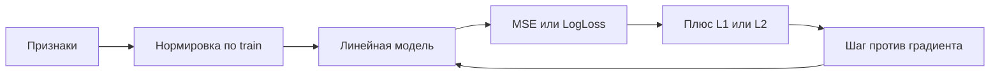

# Лекция 2. Линейные модели

Григорий Лелейтнер. Линейная регрессия, логистическая регрессия, градиентный спуск, регуляризация и нормализация. Это следующее семейство после [[Лекция 1. Введение в машинное обучение#Как устроено обучение|параметрического семейства]] с первой лекции: модель линейна по весам, лосс и способ поиска θ можно менять отдельно.

Видео:

- [2.1 Линейная регрессия](https://www.youtube.com/watch?v=khdaLtu9i-s)
- [2.2 LogLoss](https://www.youtube.com/watch?v=HV4Bm8UJwIs)
- [Логистическая регрессия](https://www.youtube.com/watch?v=twdZBko9vH4)
- [Градиентный спуск](https://www.youtube.com/watch?v=N5_VAN1nhm8)
- [Регуляризация](https://www.youtube.com/watch?v=L_o8v5A23XA)
- [2.6 Нормализация](https://www.youtube.com/watch?v=tOiwAyilk3I)

Слайды: [Линейные модели.pdf](https://github.com/DeepLearningSchool/part_1_ml_cv/blob/autumn26/week_02_linear_models/Lecture/%D0%9B%D0%B8%D0%BD%D0%B5%D0%B9%D0%BD%D1%8B%D0%B5%20%D0%BC%D0%BE%D0%B4%D0%B5%D0%BB%D0%B8.pdf)

Код с семинара: [[Сем2. ЛИНрегр]], [[Сем2. Регуляризации ЛИНрегр]], [[Сем2. ЛОГрегр]]. Что учебник ШАД добавляет сверх слайдов — в [[Лекция 2. ДОП ШАД]].

## Зачем линейная модель

- Простая, поэтому её можно объяснить: вес при признаке говорит, в какую сторону и насколько двигается ответ.
- На табличных данных с небольшим числом признаков она устойчивее гибких моделей. Слайд говорит «не переобучаются» — это про короткую линейную формулу. Полином высокой степени и лишние признаки переобучают и её, это уже было на [[Лекция 1. Введение в машинное обучение#Линейная регрессия и переобучение|первой лекции]].
- Считается дёшево: предсказание — одно скалярное произведение.

## Модель

Ищем веса $\mathbf{w}$. Свободный член прячут в вес, дописав к признакам единицу. Тогда предсказание — скалярное произведение, а по всей выборке — умножение матрицы на вектор.

![[l2_model.png]]

*Слайд лекции. Единица в признаках заменяет отдельный $b$.*

> [!tip] Тезис
> Модель линейна по параметрам, не по исходным колонкам. Признаком может быть само число, его корень или логарифм, степень, столбец one-hot или произведение двух признаков. После такой сборки формула по $\mathbf{w}$ всё равно прямая. Сборка признаков — [[Сем1. Feature engeneering|feature engineering]].

## Точное решение линейной регрессии

Лосс — средний квадрат, тот же MSE, что на [[Лекция 1. Введение в машинное обучение#Функция потерь|первой лекции]].

Если объектов столько же, сколько признаков, и $X$ обратима, система $X\mathbf{w}=\mathbf{y}$ имеет одно решение.

![[l2_exact.png]]

Обычно объектов больше, чем признаков: система переопределена, точного попадания во все $y$ нет. Псевдообратная матрица даёт решение с наименьшей квадратичной ошибкой.

![[l2_pinv.png]]

Тот же ответ получают, обнулив производную лосса. Если столбцы $X$ линейно независимы, матрица $X^\top X$ обратима.

![[l2_deriv.png]]

![[Pasted image 20261005231450.png]]

==В коде это одна строка, её пишут на [[Сем2. ЛИНрегр#Аналитическое решение|семинаре]]:==

$$\mathbf{w}=(X^\top X)^{-1}X^\top\mathbf{y}$$

> [!warning] Важно
> Формула ломается, когда столбцы линейно зависимы: обращать $X^\top X$ нельзя. Если зависимость почти линейная, матрица плохо обусловлена и веса раздуваются. Это мультиколлинеарность, её лечат регуляризацией ниже. Почему «точное» решение ещё и дорогое на больших данных — в [[Лекция 2. ДОП ШАД#Почему формулу не считают вслепую|дополнении из ШАД]]. Производные, которые здесь обнуляют, собраны в [[Лекция 2. Матрично-векторное дифференцирование]].

## От вероятности к LogLoss

Для классификации $y\in\{0,1\}$ квадрат — плохой лосс: он не знает, что ответ должен быть вероятностью. Лекция строит лосс из правдоподобия.

- $X$ и $Y$ — случайные величины. Пример: признаки человека и клик по рекламе.
- Правдоподобие — вероятность увидеть именно эту выборку, если модель верно выдаёт $P(Y=y\mid\mathbf{x})$.
- Статистика говорит: веса, максимизирующие правдоподобие, хорошие.
- Максимум произведения неудобен. Берут минус логарифм — и задача превращается в минимизацию эмпирического риска. Лосс одного объекта — минус логарифм вероятности его истинного класса.

$$L(\mathbf{w})=-\sum_{i=1}^{\ell}\ln P(Y=y_i\mid\mathbf{x}_i)$$
![[Pasted image 20261005231709.png]]
![[Pasted image 20261005231732.png]]

## Логистическая регрессия![[Pasted image 20261014004234.png|488]]

Линейная часть та же, $\mathbf{x}^\top\mathbf{w}$. Сигмоида сжимает её в $(0,1)$. Это и есть предсказанная вероятность класса 1. Поэтому метод называется регрессией: на выходе число, не метка. Порог, с которого число становится классом, к обучению не пришит. Его подбирают отдельно. Связь с [[Лекция 1. ДОП ШАД#ROC-AUC|ROC-AUC]]: в метрику идёт сама вероятность, не обрезанная метка.

![[l2_sigmoid.png]]

Подставив сигмоиду в общий лосс классификатора, получают LogLoss.

![[l2_logloss.png]]

На одном признаке обученная кривая — гладкий переход от 0 к 1. Разделяющая поверхность в нескольких признаках — гиперплоскость: сигмоида монотонна, порог по вероятности — это порог по $\mathbf{x}^\top\mathbf{w}$.

Код и картинка границы — [[Сем2. ЛОГрегр]].

### Несколько классов

Две новые функции на слайде: линейный скор каждого класса и softmax, который превращает скоры в вероятности, суммирующиеся в 1.

**Логиты (logits)** — это «сырые», неотмасштабированные вещественные числа от минус до плюс бесконечности, которые модель выдает на своем предпоследнем линейном слое до того, как к ним применят функции активации.
![[l2_softmax.png]]

![[Pasted image 20261006001503.png]]
Вероятность класса $k$ подставляется в тот же лосс «минус логарифм вероятности истинного класса». Это кросс-энтропия.

![[Pasted image 20261006001259.png]]

## Градиентный спуск

Аналитической формулы у LogLoss нет. Минимум ищут шагами против градиента. Градиент — вектор частных производных, он смотрит в сторону роста функции. Шаг длиной learning rate $\alpha$ идёт в обратную сторону.

![[l2_gd.png]]

1. Выбрать начальные веса.
2. Посчитать градиент в этой точке.
3. $\mathbf{w}\leftarrow\mathbf{w}-\alpha\nabla L(\mathbf{w})$.
4. Повторять, пока шаг не станет маленьким или не кончатся итерации.

На параболе $x^2$ производная $2x$, шаг тянет точку к нулю. Маленький $\alpha$ ползёт долго, большой перескакивает минимум. Это гиперпараметр, его не учат вместе с весами. Частные производные, из которых собран градиент, — [[Лекция 2. Функция и ее производная]] и [[Лекция 2. Производная функций нескольких переменных]].

Для линейной регрессии градиент MSE считают по одной координате. Сначала дифференцируют квадрат, потом $\mathbf{x}_i^\top\mathbf{w}$ по $w_1$ даёт признак $x_{i1}$:

![[l2_grad_lin_steps.png]]

Та же формула для каждой координаты. На слайде остаётся частная производная по $w_1$:

![[l2_grad_lin.png]]

В матричном виде это $2X^\top(X\mathbf{w}-\mathbf{y})$. Если лосс делят на $\ell$, градиент тоже делят на $\ell$.

Для логистической регрессии он короче, чем кажется по цепному правилу: множители сигмоиды сокращаются, остаётся $( \hat f(\mathbf{x})-y)\,\mathbf{x}$.

![[l2_grad_log.png]]

![[Pasted image 20261006002119.png]]
Полный градиент по всей выборке дорог. На семинаре его заменяют градиентом по батчу — [[Сем2. ЛИНрегр#Стохастический градиентный спуск|SGD]]. Когда параметров много и они сидят в слоях, тот же антиградиент считает backprop — [[Лекция 4. Полносвязная нейронная сеть#Обратное распространение]].

## Регуляризация

Если столбцы $X$ линейно зависимы, существует ненулевой $\boldsymbol\alpha$, такой что $X\boldsymbol\alpha=0$. Тогда $\mathbf{w}$ и $\mathbf{w}+\boldsymbol\alpha$ дают одни и те же предсказания. Решений бесконечно много, и среди них есть сколь угодно большие веса.

Weight decay дописывает к лоссу штраф за величину весов. $\beta$ на слайде — коэффициент регуляризации, гиперпараметр. Свободный член обычно не штрафуют: общий сдвиг ответа не делает модель сложнее.

![[l2_reg.png]]

- $L_2$ (Ridge) — сумма квадратов. Веса уменьшаются, но редко становятся нулём. К градиенту добавляется $2\beta w_j$. Формула $(X^\top X+\beta I)^{-1}X^\top y$ снова замкнутая: к диагонали $X^\top X$ добавляют $\beta$, матрица отходит от вырожденной.
- $L_1$ (Lasso) — сумма модулей. Градиент штрафа — знак веса. Часть весов обнуляется, это отбор признаков. Аналитического решения нет.
![[Pasted image 20261006003452.png|659]]
![[Pasted image 20261006004107.png]]
![[Pasted image 20261006004237.png]]![[Pasted image 20261006004313.png]]
## 3. ElasticNet

![[Pasted image 20261006004335.png]]

![[l2_grad_reg.png]]

Как это выглядит и почему Lasso зануляет столбцы — [[Сем2. Регуляризации ЛИНрегр]]. Подбор $\beta$ по логарифмической шкале на validation, не на test, уже записан в [[Лекция 1. ДОП ШАД#Параметры и гиперпараметры|дополнении первой лекции]].

## Нормализация

$$x_j\leftarrow\frac{x_j-\mu_j}{\sigma_j}$$

$\mu_j$ и $\sigma_j$ — среднее и стандартное отклонение признака на train. Test нормируют теми же числами. Это тот же [[Сем1. Pandas, Matplotlib#Train/test и масштабирование|StandardScaler]].

![[Pasted image 20261006004825.png]]
![[Pasted image 20261006005005.png|550]]

==Зачем, если формула и так линейная==:

- градиентный спуск на признаках разного масштаба идёт зигзагом;
- регуляризация штрафует веса одинаково, только если признаки в одном масштабе, иначе штраф достаётся признаку с мелкими числами;
- после нормировки величина веса читается как важность признака.

Следующее семейство после линейной модели — [[Лекция 3. Решающие деревья]]. Из нескольких таких моделей собирают [[Лекция 3. Композиции алгоритмов|ансамбль]].
