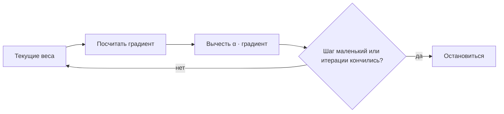

# Лекция 2. Градиент и градиентный спуск

На [[Лекция 2. Линейные модели#Градиентный спуск|лекции]] минимум лосса ищут шагом против градиента. Здесь разбирается сам шаг: куда смотрит градиент, почему его вычитают и от чего зависит длина. Частная производная, из которой градиент собран, лежит в [[Лекция 2. Производная функций нескольких переменных]]. Производная одной переменной — в [[Лекция 2. Функция и ее производная]].

Картинка шага по одной координате: [Gradient descent, how neural networks learn](https://www.youtube.com/watch?v=IHZwWFHWa-w), 3Blue1Brown, до момента, где появляются слои. Слои сюда не входят.

## Что такое градиент

У функции одной переменной направление задаёт знак производной. Производная положительна, функция растёт при движении вправо. Отрицательна, растёт при движении влево. Ноль, это подозрительная точка: минимум, максимум или полка.

У функции нескольких переменных таких направлений много. Градиент собирает частные производные в один столбец:

$$\nabla L(\mathbf{w})=\begin{pmatrix}\partial L/\partial w_1\\ \partial L/\partial w_2\\ \vdots\end{pmatrix}$$

Координат столько, сколько весов. У линейной регрессии это все $w_j$ и свободный член.

Градиент смотрит в сторону самого быстрого роста. Длина говорит, насколько там круто. Против градиента функция в первом приближении убывает. Поэтому шаг обучения идёт со знаком минус.

> [!tip] Тезис
> Градиент не «куда хотим прийти». Это направление подъёма в текущей точке. Минимум ищут, вычитая его.

Пример. $L(w_1,w_2)=(w_1-1)^2+(w_2-2)^2$. Дно в точке $(1, 2)$.

$$\nabla L=\begin{pmatrix}2(w_1-1)\\ 2(w_2-2)\end{pmatrix}$$

В $(0,0)$ градиент равен $(-2,-4)$. Он смотрит от дна, в сторону роста. Антиградиент $(2,4)$ смотрит к $(1,2)$.

## Один шаг

$$\mathbf{w}\leftarrow\mathbf{w}-\alpha\nabla L(\mathbf{w})$$

$\alpha$ — длина шага, learning rate. Это гиперпараметр: его задают до обучения, вместе с весами он не ищется. Что такое гиперпараметр, записано в [[Лекция 1. ДОП ШАД#Параметры и гиперпараметры|дополнении первой лекции]].

Цикл один и тот же, сколько бы координат ни было.

На одной параболе это видно без вектора. $L(w)=(w-3)^2$, производная $L'(w)=2(w-3)$, минимум в $w=3$. Старт $w=0$, $\alpha=0.25$.

| шаг | $w$ | производная | новый $w$ |
| --- | --- | --- | --- |
| 0 | 0 | −6 | 1.5 |
| 1 | 1.5 | −3 | 2.25 |
| 2 | 2.25 | −1.5 | 2.625 |
| 3 | 2.625 | −0.75 | 2.8125 |

Считается так: $0-0.25\cdot(-6)=1.5$. Точка ползёт к 3 и каждая поправка меньше предыдущей, потому что у дна производная сама становится маленькой.

![[gd_parabola.png|720]]

Слева тот же расчёт. Справа $\alpha=1.1$: первая поправка перебрасывает точку за минимум, следующая перебрасывает обратно, и размах растёт. Функция при этом не обязана убывать. Маленький шаг убывает медленно, но предсказуемо. Большой может разойтись.

Почему маленький шаг вообще уменьшает функцию. В окрестности точки

$$L(\mathbf{w}-\alpha\nabla L)\approx L(\mathbf{w})-\alpha\|\nabla L\|^2$$

Второе слагаемое отрицательно, пока градиент не ноль и $\alpha>0$. Это линейное приближение. Оно верно для достаточно маленького $\alpha$. Для большого в игру входят следующие члены, и приближение врёт. Отсюда картинка справа, а не из «шаг всегда вниз».

Остановка. На практике смотрят одно из двух: градиент стал почти нулевым, или кончился запас итераций. Ноль градиента сам по себе не доказывает, что это минимум. У параболы да. У функции с горбами ноль бывает и на максимуме, и на седле.

## Откуда берётся число в градиенте

Один объект, прогноз $wx$, ответ $y$, лосс квадрат ошибки:

$$L(w)=(wx-y)^2$$

Цепное правило из [[Лекция 2. Функция и ее производная#Четыре правила|заметки про производную]]: внешняя степень даёт $2(wx-y)$, внутренняя даёт $x$.

$$\frac{dL}{dw}=2(wx-y)\,x$$

На нескольких объектах лосс обычно делят на их число $\ell$. Тогда и градиент делят на $\ell$:

$$\frac{dL}{dw}=\frac{2}{\ell}\sum_{i=1}^{\ell}(wx_i-y_i)\,x_i$$

Множитель 2 часто впитывают в $\alpha$ и в коде его не пишут. На слайде лекции он остаётся. В матричном виде тот же счёт без индекса $i$ выглядит так, как на лекции: $2X^\top(X\mathbf{w}-\mathbf{y})$. Если лосс делили на $\ell$, градиент тоже делят на $\ell$.

Для логистической регрессии цепочка длиннее, сигмоида сокращается, остаётся $(\hat f(\mathbf{x})-y)\,\mathbf{x}$. Это уже [[Лекция 2. Линейные модели#Градиентный спуск|слайд]], здесь ту же цепочку не раскладываем.

> [!example] Один вес руками
> $x=2$, $y=6$, старт $w=0$, $\alpha=0.05$, лосс без деления на $\ell$. Производная $2(2w-6)\cdot 2=8w-24$. В нуле она равна $-24$. Новый вес $0-0.05\cdot(-24)=1.2$. Прогноз был 0, стал $2\cdot 1.2=2.4$. До ответа 6 ещё далеко, но ошибка уменьшилась. Истинный вес здесь 3. Следующие шаги добирают его тем же правилом.

## Яма линейной регрессии

MSE линейной модели по весам — чаша. У чаши один минимум, второго дна нет. Градиентный спуск не застревает в «другой яме», потому что другой нет. Он может не дойти, если шаг слишком большой, и может ползти очень долго, если шаг крошечный.

Если столбцы $X$ линейно зависимы, дно не точка, а целое дно-жёлоб: много разных $\mathbf{w}$ дают один и тот же прогноз. Закрытая формула тогда не пишется. Штраф на веса, который выбирает среди них короткие, разобран в [[Лекция 2. Линейные модели#Регуляризация|регуляризации]].

У лосса, который не является такой чашей, ноль градиента может быть плохой точкой. Долю ошибок как раз поэтому не минимизируют шагом: она кусочно-постоянная, производная почти везде ноль. Это сказано в [[Лекция 2. ДОП ШАД#Почему классификацию не учат квадратом|дополнении]].

## Масштаб признаков

Один и тот же $\alpha$ стоит во всех координатах. Если по одной оси яма узкая, а по другой пологая, короткий шаг для узкой оси почти не двигает пологую. Шаг, которого хватает пологой оси, узкую перескакивает.

![[gd_scale.png|720]]

Слева $w_1^2+w_2^2$, линии уровня круги. Справа $w_1^2+20\,w_2^2$, линии вытянуты. Старт и $\alpha$ одни и те же. Слева точка идёт к центру. Справа координата $w_2$ дёргается поперёк ямы, а $w_1$ ползёт.

Поэтому перед спуском признаки приводят к одному масштабу. Среднее и стандартное отклонение берут по train, test нормируем теми же числами. Зачем это ещё и регуляризации, записано в [[Лекция 2. Линейные модели#Нормализация|нормализации]].

## Вся выборка и один батч

Градиент выше собран по всем объектам. На большой таблице это дорого: каждый шаг перечитывает все строки.

На семинаре сумму заменяют суммой по батчу, пачке строк. Правило шага то же, оценка градиента шумная. Это [[Сем2. ЛИНрегр#Стохастический градиентный спуск|SGD]]. Шум не отменяет знак минус перед градиентом и не отменяет выбор $\alpha$.

## Что проверить на черновике

- Градиент вычитают. Плюс в формуле шага пошёл бы в сторону роста лосса.
- $\alpha$ не учат вместе с $\mathbf{w}$. Перебор $\alpha$ делают по validation, не по test.
- В нуле модуля производной нет. Штраф $L_1$ в нуле на [[Сем2. Регуляризации ЛИНрегр|семинаре]] поэтому подменяют гладким `soft_sign`.
- Делили лосс на $\ell$ — делят и градиент. Иначе шаг в $\ell$ раз длиннее, чем задумано.
- Признаки разного масштаба при одном $\alpha$ дают зигзаг с правой картинки. Сначала нормировка, потом спуск.
